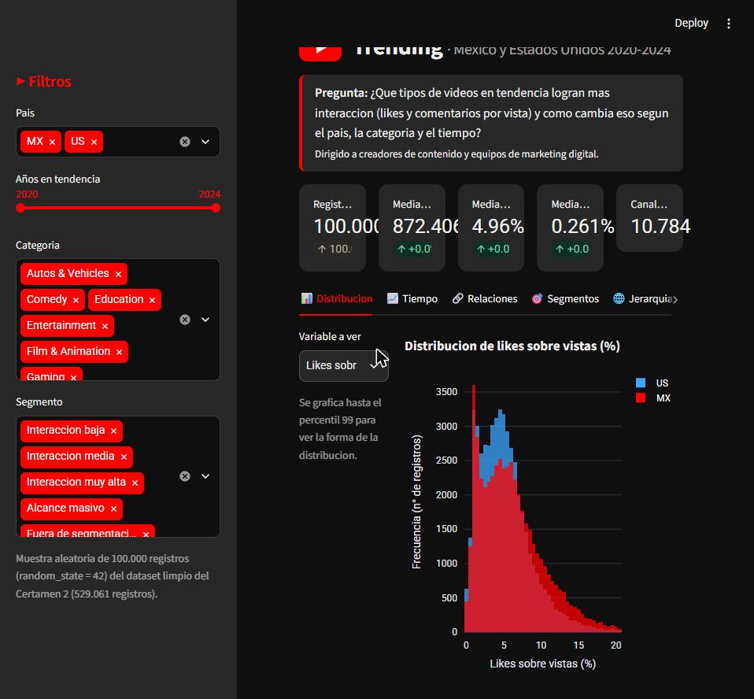

# ▶ Dashboard YouTube Trending — México y Estados Unidos (2020-2024)

Dashboard interactivo del examen final de **Visualización de la Información (UDD, 2026)**. Transforma el análisis exploratorio del Certamen 2 en una app web hecha con **Streamlit + Plotly Express**.

**App publicada:** https://dashboard-trending-mx-us.streamlit.app

**Versión:** v2.1.0-beta (Hito 1)



## Pregunta que responde

> ¿Qué tipos de videos en tendencia logran más interacción (likes y comentarios por vista) y cómo cambia eso según el país, la categoría y el tiempo?

**Usuario objetivo:** creadores de contenido y equipos de marketing digital.

## Integrantes

- Leonel Fernández
- Vicente Aravena
- Alonso Canales

## Datos

- **Fuente:** [YouTube Trending Video Dataset](https://www.kaggle.com/datasets/rsrishav/youtube-trending-video-dataset) (Kaggle, licencia CC0). Archivos de México y Estados Unidos.
- **Limpieza (igual al Certamen 2):** 537.385 registros → **529.061** tras eliminar duplicados (mismo video, día y país), videos con 0 vistas y videos publicados después de su día en tendencia.
- **Variables creadas:** `categoria` (desde los JSON de categorías), `likes_pct`, `comentarios_pct`, `anio`, `anio_mes`, `dia_semana`, `dias_a_tendencia` y `segmento`.
- **Muestra:** el dataset limpio supera los 25 MB, por eso la app usa una **muestra aleatoria de 100.000 registros con `random_state=42`** (`data/youtube_limpio_muestra.csv`, 19 MB).
- **Mapa:** `data/paises.geojson` contiene los contornos de México y Estados Unidos (de [johan/world.geo.json](https://github.com/johan/world.geo.json)).

## Segmentación (componente avanzado)

El dataset no tiene latitud ni longitud, por lo que el componente avanzado es la **segmentación con K-Means** del Certamen 2:

- Variables: vistas, % de likes y % de comentarios, escaladas con `StandardScaler` (hasta el percentil 99).
- **k = 4** elegido con el método del codo (gráfico en la app).
- Segmentos: Interacción baja (51,8 %), Interacción media (34,9 %), Interacción muy alta (9,4 %) y Alcance masivo (3,9 %).

## Contenido del dashboard

| Sección | Qué muestra |
|---|---|
| Filtros (panel lateral) | País, años, categoría y segmento |
| KPIs | Registros, vistas, % likes, % comentarios (con `delta` contra el total) y canales |
| Distribución | Histograma con selector de variable (control local) y barras por categoría |
| Tiempo | Mediana mensual por país |
| Relaciones | Dispersión vistas vs % likes con selector de color (control local) |
| Segmentos | Método del codo, radar (`px.line_polar`), dispersión por segmento, tabla de perfiles y selector de segmento |
| Jerarquía y perfiles | Sunburst país → categoría → segmento y coordenadas paralelas |
| Mapa | Coropleta por país con `px.choropleth_map` |

## Estructura del repositorio

```
├── app.py                  ← la app de Streamlit
├── preparar_datos.py       ← limpieza, segmentación y muestra (se corre una vez en local)
├── requirements.txt        ← librerías que instala Streamlit Cloud
├── .streamlit/config.toml  ← tema oscuro estilo YouTube
├── data/
│   ├── youtube_limpio_muestra.csv
│   ├── codo.csv
│   └── paises.geojson
└── captura.jpg
```

## Ejecutar en local

```bash
pip install -r requirements.txt
streamlit run app.py
```
